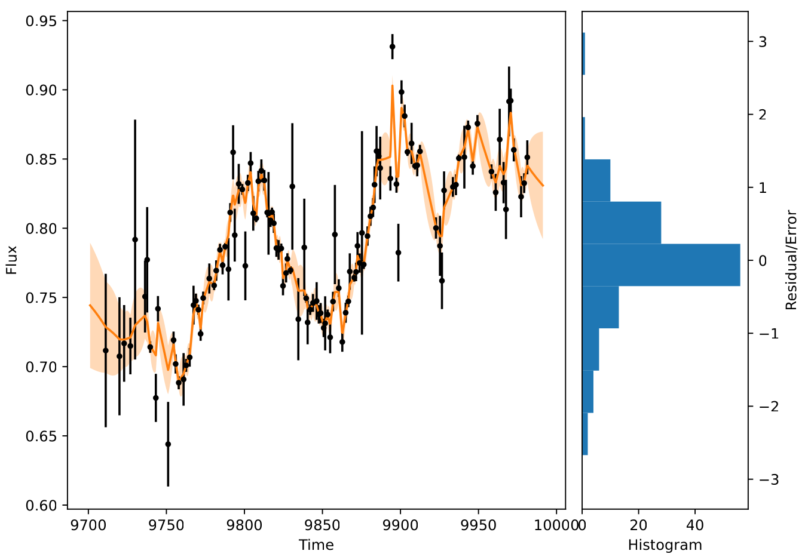
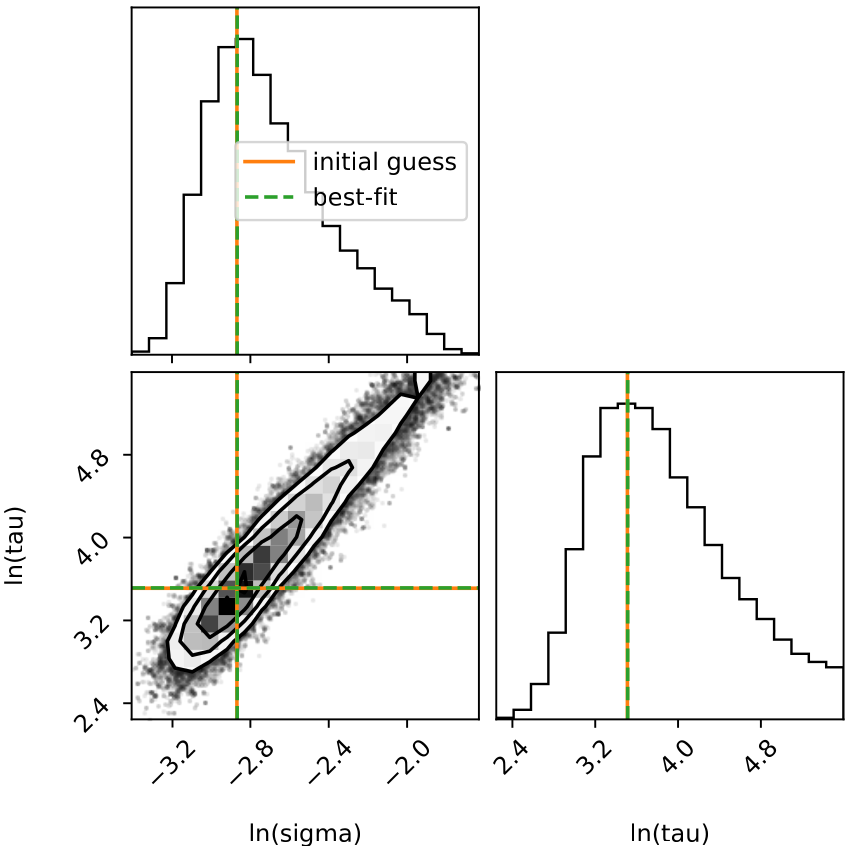

.. _drw_label:

DRW Modeling
============
Damped random walk (DRW) model is a Gaussian process model with a damped exponential covariance function as 

.. math:: 
    S_{ij} = \sigma_d^2 \exp\left(-\frac{\Delta t_{ij}}{\tau_d}\right),

where :math:`\sigma_d^2` is the variance parameter, :math:`\tau_d` is the damping time scale, 
and :math:`\Delta t_{ij}` is the time difference between two points. The corresponding 
power spectral density is 

.. math:: 
    P(f) = \frac{4\sigma_d^2\tau_d}{1 + (2\pi f\tau_d)^2},

where :math:`f` is the frequency. 

PyAT Implementation
-------------------
PyAT employs the package `celerite <https://celerite.readthedocs.io/en/stable/>`_ to implement 
the DRW modeling and provides a friendly interface.

.. function:: drw_modeling(t, y, yerr, doshow=False, return_prob=False)

    :synopsis: DRW modeling. Return the posterior sample of the DRW parameters (sigma, tau) and 
               the probability of the sample if return_prob is True.

    :param t: Time array.
    :param y: Data array.
    :param yerr: Error array.
    :param doshow: Whether to show the plot.
    :param return_prob: Whether to return the probability.
    :return: sample, [probability]

             sample is the posterior sample of the DRW parameters (sigma, tau).
             probability is the probability of the sample if return_prob is True.
    :rtype: numpy.ndarray, [numpy.ndarray]

.. function:: drw_modeling_fast(t, y, yerr)

    :synopsis: Fast DRW modeling by only determining the best-fit parameters.

    :param t: Time array.
    :param y: Data array.
    :param yerr: Error array.
    :param doshow: Whether to show the plot.
    :param return_prob: Whether to return the probability.
    :return: sigma, tau
    
             sigma, tau are the best-fit parameters.
    :rtype: float, float

.. function:: drw_recon(t, y, yerr)

    :synopsis: DRW reconstruction. Return the reconstructed data.

    :param t: Time array.
    :param y: Data array.
    :param yerr: Error array.
    
    :return: t_rec, y_rec, ye_rec
    
             t_rec, y_rec, ye_rec are the reconstructed time array, reconstructed data array, 
             and reconstructed error array respectively.
    :rtype: numpy.ndarray, numpy.ndarray, numpy.ndarray

Examples
--------

First import PyAT in a Python script as follows:

.. code-block:: python

    import pyat

Then load the light curve data., e.g.:abbr:

.. code-block:: python

    import numpy as np

    lc = np.loadtxt("lc1.txt")

    # do DRW modeling, return posterior sample and probability
    sample, prob = pyat.drw_modeling(lc[:,0], lc[:,1], lc[:,2], doshow=True, return_prob=True)

    # calculate best-fit parameters from posterior sample
    sigma, tau = np.exp(np.median(sample, axis=0))
    print("best-fit parameters: sigma={:.4f}, tau={:.4f}".format(sigma, tau))

The output is as follows:

.. code-block:: bash

    best-fit parameters: sigma=0.0641, tau=43.0815

    DRW modeling and reconstruction.

    DRW parameter distribution.

If one only wants to determine the best-fit parameters, use the fast modeling function as follows:

.. code-block:: python

    sigma, tau = pyat.drw_modeling_fast(lc[:,0], lc[:,1], lc[:,2])
    print("best-fit parameters: sigma={:.4f}, tau={:.4f}".format(sigma, tau))

To reconstruct the data, use the following code:

.. code-block:: python

    t_rec, y_rec, ye_rec = pyat.drw_recon(lc[:,0], lc[:,1], lc[:,2])

    # plot the reconstructed data
    plt.plot(t_rec, y_rec, label="reconstructed data")
    plt.fill_between(t_rec, y1=y_rec + ye_rec, y2=y_rec - ye_rec, color="gray", label="data")
    plt.legend()
    plt.show()